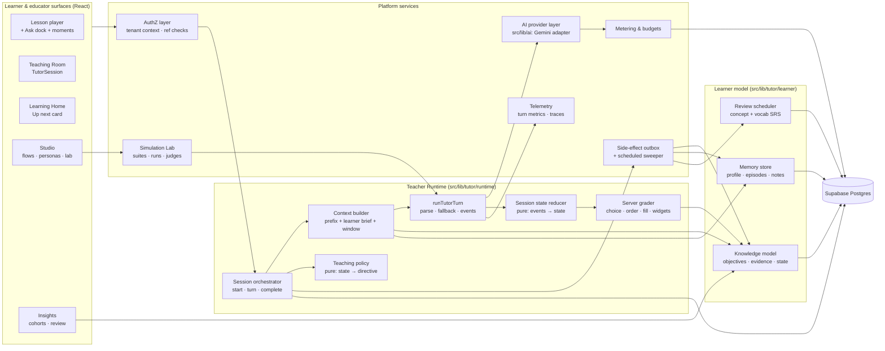
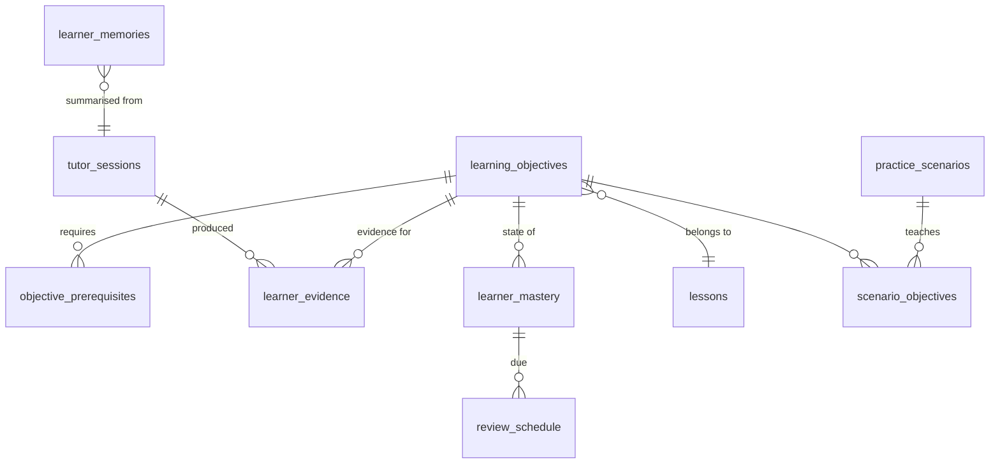

# World-Class AI Teacher — Target Architecture

Status: proposal, 2026-11-24. Builds on what exists (see [AUDIT](WORLD_CLASS_AI_TEACHER_AUDIT.md)); every component
below names the code it evolves from. No rewrite, no new services, no vector database. Decisions and alternatives are in
[DECISIONS](WORLD_CLASS_AI_TEACHER_DECISIONS.md) (referenced as D-xx).

---

## 1. Design goals

1. **One engine.** Every learner-facing AI interaction (lesson ask, moments, practice, sprint, viva, preview, demo, try,
   simulation) runs through one Teacher Runtime built on `runTutorTurn(deps)`.
2. **One learner model.** One knowledge model (objectives + evidence + state) and one memory store, tenant-scoped,
   learner-visible.
3. **Evidence you can trust.** Prefer server-graded evidence; label AI judgements; never let the client assert
   correctness.
4. **Backward-compatible contract.** Event contract v2 stays valid; v3 is additive; stored v1/v2 turns replay forever.
5. **Cheap by construction.** Stable cacheable prefixes, bounded history, right model per task, metered everywhere.
6. **Safe by construction.** One authorisation layer that derives tenant from the resource, never from the client.
7. **Testable.** Pure reducers and policies with unit tests; the runtime runnable with in-memory deps for simulation.

## 2. System overview



### Code layout (target)

```
src/lib/ai/
  provider.ts            NEW  interfaces: TextModel, StreamModel, SpeechModel, RealtimeModel
  gemini/                NEW  adapter (moves code from tutor/server/gemini-calls.ts, gemini-models.ts, authoring/server.ts)
  models.ts              KEEP task → {model, tier, fallbacks}; add per-task budgets
  call.ts                NEW  aiCall(task, …) = provider + metering + telemetry + fallback (single choke point)
src/lib/tutor/
  contract/              NEW  single source: events, board widgets → generates Zod, Gemini schema, Live tools
  runtime/               NEW  orchestrator, context builder, policy, state reducer, grader (moves from server/*)
  learner/               NEW  knowledge model, memory, scheduler (evolves mastery/*, memory.ts, srs.ts)
  authoring/             KEEP + versioning, objective registry writes
  eval/                  NEW  simulator, judges, suites (evolves authoring/stress-test.ts)
  server/                SHRINKS to route-facing glue (access, session-store)
src/lib/authz/           NEW  getTenantContext, requireStaff, assertRefsInTenant (consolidates 4 copies)
```

## 3. The Teacher Runtime

### 3.1 Surfaces become session *origins*, not separate stacks

`tutor_sessions.origin` already has `lesson | assignment | practice`. Extend to:

| Origin | Replaces | Mode defaults | Persisted | Notes |
|---|---|---|---|---|
| `ask` | `/api/ai/tutor` dock stack | text (stream), voice optional | yes (retention 90 days default) | Lesson-scoped; may be "open" (no flow) |
| `moment` | `tutor_session` block card + teacher moments | voice/text | yes | Always lesson-scoped, pinned flow version |
| `practice` | — | as today | yes | |
| `assignment` | — | as today | yes | Staff-visible by rule |
| `revision` | sprint (`scenario_id=null` + `sprint_context`) | voice/text | yes | Built by scheduler, not "3 weakest" only |
| `viva` | viva via practice | voice preferred | yes | Staff-visible; human review route |
| `preview` | `/api/ai/teacher/preview/*` | text | ephemeral (24h) | Staff only, metered to tenant |
| `simulation` | stress-test | text | eval tables | Never touches learner model |
| `demo` / `try` | `/api/tutor/demo`, `/api/tutor/try` | text/voice | none | In-memory deps, metered to platform |

All origins share `runTutorTurn`, `buildContext`, the contract and the grader. The only per-origin differences are the
**deps** (DB vs memory), **policy defaults** and **visibility rules** — expressed as data in one `ORIGIN_PROFILES`
table, not as forks.

### 3.2 Streaming for Ask (closing the dock's one real advantage)

The dock streams text; the session engine returns whole JSON. To migrate the dock without regressing perceived
latency, add `runTutorTurnStream`: request JSON with the same schema in streaming mode and run an **incremental event
parser** over the `events` array, emitting each event as soon as its object closes (first `say` arrives in ~the same
time as today's first text chunk). Fallback: if streaming JSON is unreliable for a model, the Ask surface uses
non-streaming JSON plus an immediate "thinking" gesture (D-04).

### 3.3 Session state and the Teaching Policy

Today the model re-derives the session from history every turn. Add an explicit, server-owned state:

```ts
// tutor_sessions.state (jsonb), versioned
type SessionState = {
  v: 1;
  flowVersion: number | null;
  objectives: { id: string; status: "pending" | "teaching" | "checking" | "met" | "partial" | "review"; attempts: number; hints: number; lastResult?: Result }[];
  currentObjectiveId: string | null;
  stepIdx: number;
  strategy: StrategyId;             // current teaching strategy
  pendingCheck?: PendingCheck;      // server-held answer key (see 3.4)
  confidence?: 1 | 2 | 3 | 4 | 5;   // last ask_confidence
  learnerTurns: number;
  summary?: string;                 // rolling summary of turns older than the window
};
```

- `reduceSessionState(state, events, learnerInput)` — **pure**, unit-tested; runs after each turn.
- `teachingPolicy(state, learnerBrief, flow) → Directive` — **pure**, unit-tested; runs before each turn.

```ts
type Directive = {
  move: "probe" | "explain" | "worked_example" | "demonstrate" | "hint" | "simplify" | "check"
      | "prerequisite" | "stretch" | "independent_task" | "recap" | "wrap_up";
  objectiveId: string | null;
  reason: string;              // e.g. "2 failed checks on obj-3; switch to worked example"
  constraints?: string[];      // e.g. ["one question only", "use show_board steps"]
};
```

The directive is injected as a short **per-turn teacher note** at the end of `contents` (not the system prompt, so the
cached prefix is untouched). The model can still deviate when the learner asks something else; the reducer notices.

Policy rules (initial, all data-driven per strategy, see §5):
- 2 consecutive `misconception` on the same objective → `worked_example`, then `check`; 3 → `prerequisite` if one is
  registered, else flag for review.
- Correct with low confidence (≤2) → one more `check` at a different representation before marking `met`.
- Correct twice, high confidence, time left → `stretch` or `independent_task` (transfer evidence).
- Off-topic twice → brief answer + redirect.
- ≤90 s left → `recap` then `wrap_up`.

This is not a rigid state machine: the policy *recommends*; the flow's beats are a plan, not a script.

### 3.4 Server-graded interactions (trustworthy evidence)

Contract v3 adds **answerable** interactions where the model supplies the answer key and the server keeps it:

| Event | Client sees | Server holds | Graded by |
|---|---|---|---|
| `ask_choice` (+`answer`) | options | correct option id(s), objective id | exact match |
| `ask_order` NEW | shuffled items | correct order | exact / partial credit |
| `ask_fill` NEW | text with blanks | accepted answers (normalised, synonyms) | normalised match, then model if ambiguous |
| `ask_numeric` NEW | prompt, unit | value, tolerance | tolerance check |
| `show_board` widget with `check` | interactive widget | widget answer spec | widget's `grade()` |

Flow: model emits event with answer → pipeline moves the answer into `state.pendingCheck` and strips it from the
outbound event → learner responds via `/turn` with `{ interaction: { id, value } }` → grader produces a
`server_verified` evidence row and tells the model the result in the next turn's teacher note. This replaces regex
inference in `turn-interaction.ts` and makes `ask_choice` evidence unforgeable.

### 3.5 Context builder and caching

```
┌──────────── cached prefix (shared across learners of a flow version) ────────────┐
│ platform rules + contract (pack-filtered) + safety                               │
│ skill pack + persona (fenced) + teaching philosophy                              │
│ flow version: objectives (with ids), beats, targets                              │
│ lesson content (fenced <lesson_content>, ≤24k chars)                             │
└──────────────────────────────────────────────────────────────────────────────────┘
┌─ per-learner (not cached) ─┐ ┌─ window ─────────────────┐ ┌─ per-turn ───────────┐
│ learner brief ≤ ~600 tok:  │ │ rolling summary (if any) │ │ teacher note         │
│ profile, prefs, objective  │ │ + last 8 turns verbatim  │ │ (policy directive,   │
│ states, top misconceptions,│ │                          │ │  grading result)     │
│ last-session summary       │ │                          │ │ + learner input      │
└────────────────────────────┘ └──────────────────────────┘ └──────────────────────┘
```

- Cache key: `hash(prefix)`; stored in a **DB table** (`ai_prompt_caches(key, provider_name, expires_at)`) instead of an
  in-process map, so instances share caches; creation runs in `after()` on the first turn and is used from turn 2
  (no awaited latency on turn 1).
- History window: last 8 turns verbatim; when the window overflows, summarise the dropped turns with the cheap model
  (`tutorSummary` task) into `state.summary`. Bounded cost per turn instead of quadratic growth.
- All tenant-authored text (persona, scenario, objectives) and stored learner-derived text are fenced in tagged blocks
  with the existing "data, not instructions" guard. Learner brief strings are length-capped and stripped of
  instruction-like markup.

### 3.6 Model routing (D-02, D-03)

| Task | Tier | Default (today's ids) | Notes |
|---|---|---|---|
| `tutorTurn` (sessions, ask, moments, viva) | smart-fast | `gemini-3.8-flash` | thinking low; streaming for ask |
| `tutorLive` | realtime | `gemini-3.8-live` | voice-first sessions |
| `tutorSummary`, `memoryExtract` | cheap | `gemini-3.5-flash-lite` | post-session, async |
| `tutorReport` | smart-fast | `gemini-3.8-flash` | async via outbox where possible |
| `teacherAuthoring`, `objectiveExtract` | smart | `gemini-3.8-flash` (thinking medium) | low volume, quality matters |
| `evalLearnerSim` | cheap | flash-lite | many calls |
| `evalJudge` | smart, **different model than the tutor** where possible | | temperature 0 |
| `tutorTts`, `tutorTranscribe` | speech | as today | TTS cached by text+voice hash (exists) |

All calls go through `aiCall(task, input)` which applies: model + fallback chain, metering (tokens in/out/cached), budget
check, telemetry, and error classification. Swapping a provider for a task = add an adapter implementing
`provider.ts`; Live/realtime remains Gemini-specific (only supported realtime path today).

## 4. Learner model

### 4.1 Domain model



**`learning_objectives`** NEW — the registry that fixes key fragmentation.
`id uuid, company_id, course_id, lesson_id null, code text (stable, e.g. "L3.O2"), text, evidence_criteria, level
(remember|understand|apply|analyse), locale, status (draft|active|retired), source (authored|extracted|legacy),
created_by, created_at`. Prereqs in `objective_prerequisites(objective_id, requires_id)`.
`scenario_objectives(scenario_id, objective_id, weight)` links flows to objectives (persists what the lesson panel
already extracts).

**`learner_evidence`** EVOLVE (add columns; keep existing):
`objective_id uuid null` (FK), `source` (`quiz | interaction | widget | viva_check | teacher_judgement | self_report |
legacy_ai`), `server_verified bool`, `score numeric 0..1`, `difficulty smallint null`, `item_ref text` (quiz question id,
interaction id), `weight numeric`. Existing rows backfilled `source='legacy_ai'`.

**`learner_mastery`** EVOLVE in place (D-05 — no parallel table):
add `objective_id uuid null`, `p_mastery numeric`, `confidence numeric`, `stability_days numeric`,
`next_review_at timestamptz`, `status` (`unseen|learning|practising|secure|needs_review`). Replace the unique key with
`(company_id, user_id, objective_key)` where `objective_key = objective_id::text` for registered objectives (legacy keys
keep their text form). Old `level` stays, derived from `p_mastery` for backward compatibility during the transition.

### 4.2 Evidence weighting and update rule (D-06)

Explainable, cheap, tunable; upgradeable to BKT/IRT when data exists.

```
weight w  = sourceWeight[source] × difficultyFactor × (server_verified ? 1 : 0.6)
            sourceWeight: quiz 1.0 · interaction 1.0 · widget 1.0 · viva_check 1.0
                          teacher_judgement 0.5 · self_report 0.1 (confidence only) · legacy_ai 0.4
outcome o = score (correct 1, partial 0.5, misconception 0)
p'        = p + α·w·(o − p)            α = 0.35 first evidence, 0.25 after
confidence= 1 − exp(−Σ recent w / 3)   (recent = last 60 days, recency-discounted)
retention r(t) = exp(−t / stability)   applied at read time: p_effective = p × r
stability: on a successful *spaced* review (gap ≥ 0.5 × stability) stability ×= 2.0–2.5; on failure → max(1, stability × 0.5)
status   : unseen (no evidence) · learning (p<0.4) · practising (0.4–0.8 or confidence<0.5)
           · secure (p_eff≥0.8 ∧ confidence≥0.5 ∧ ≥2 sources or ≥1 spaced review) · needs_review (secure but p_eff<0.7)
next_review_at = now + stability × ln(1/0.85)   (target 85% recall)
```

Properties the audit asked for: distinguishes unseen from failed; recency and decay; difficulty and source weighting;
transfer (independent tasks get `difficulty` 3); AI opinion is down-weighted and labelled; mastery requires evidence
*after a gap*, which is the retention test.

Writes are **one SQL function** `record_evidence(…)` (SECURITY DEFINER, `search_path=public`) that inserts evidence and
updates mastery **in one transaction** with row locking — fixes the race and lost updates. The pure TS version of the
rule lives in `src/lib/tutor/learner/knowledge.ts` with tests; a SQL/TS parity test runs both on fixtures.

### 4.3 Sources of evidence

| Source | Producer | Verified |
|---|---|---|
| Quiz attempt per question | `actions/quizzes.ts` on submit → `record_evidence` per question with `objective_id` (questions get an optional objective link; AI suggests, creator confirms) | yes |
| Contract interactions (`ask_choice/order/fill/numeric`) | Runtime grader | yes |
| Widgets with `check` | Runtime grader | yes |
| Viva checks | Runtime grader + teacher judgement | mixed |
| Open answers judged by the teacher (`note_evidence`) | Model, constrained to `objective_id` from the session's list | no (0.5) |
| Confidence ratings | `ask_confidence` | calibration only |
| Lesson completion | **not evidence** (progress ≠ competence) | — |

`note_evidence.objective` becomes an **objective id** from the enumerated list in the prefix (string, loose schema; the
server maps unknown values to the current objective or drops them). Legacy free-text still accepted for old flows.

### 4.4 Memory

**`learner_memories`** NEW (tenant-scoped, learner-visible):
`id, company_id, user_id, kind (goal|background|preference|episode|misconception|note), content (≤500 chars),
source (learner_stated|session_summary|teacher_observed|staff_note), source_ref, course_id null, confidence,
visible_to_staff bool (default per tenant policy), status (active|hidden|deleted), expires_at, created_at, updated_at`.

- **Write paths:** first-meeting question (learner_stated); post-session summariser (cheap model, outbox) produces ≤1
  `episode` and ≤3 `misconception`/`preference` candidates with source_ref; learner edits in "What my teacher knows".
- **Read path:** `buildLearnerBrief(userId, companyId, courseId)` — deterministic selection (active, not expired;
  goals+prefs always; last 2 episodes for the course; misconceptions linked to objectives in this flow; weakest 5
  objective states) → ≤600 tokens. No embeddings needed at this scale (D-07).
- **Learner controls:** view all, edit text, hide from teacher, delete (hard delete of row + linked evidence detail
  text redacted), "forget this course", export (JSON). Staff see a memory item only if `visible_to_staff` and the
  tenant policy allows.
- **Retention:** episodes 12 months, ask sessions 90 days (turn text), evidence kept (needed for mastery) but `detail`
  free text redacted after 12 months; tenant-configurable within platform bounds. Nightly sweeper enforces.
- `learner_language_profiles.memory` (recent mistakes) is **migrated into** `learner_memories` (`kind=misconception`) and
  then read-only; streak fields move to a per-user `learner_habits` row (not per language), fixing subject mixing.
- **Global preferences** (voice/text, speed, captions, data saver, reduced motion, UI language) in
  `learner_preferences(user_id)` — not tenant-scoped, because they are about the person's device and needs.

### 4.5 Review scheduler

One scheduler for concepts and vocab: `learner_mastery.next_review_at` for objectives, `learner_vocab.due_at` for cards.
`planReviews(userId, companyId, budgetMinutes)` (pure) picks due items, interleaves 2–3 objectives, prefers
prerequisites of what the learner is currently studying, and produces a `revision` session spec (replacing "3 weakest
objectives"). Delayed **retention checks** are just reviews scheduled 7 and 30 days after first reaching `secure`.

## 5. Teaching methodology framework

Strategies are **data** (`src/lib/tutor/runtime/strategies.ts`), not prompts scattered across packs:

| Strategy | When the policy picks it | Moves emphasised | Evidence produced |
|---|---|---|---|
| Probe / diagnose | Session start; objective unseen | probe, check | baseline |
| Guided instruction | Unseen/learning; beginner profile | explain → check | interaction |
| Socratic | Practising; confident learner; conceptual objective | question chains, hint | teacher judgement + interaction |
| Worked example → faded | 2 misses; procedural objective | worked_example, then partial, then independent | interaction |
| Demonstration | Skills/tools objectives; widget available | demonstrate (widget/clip), then try | widget |
| Conversational | Ask origin; open questions | explain briefly, offer check | optional |
| Problem-based | Secure prerequisites; apply/analyse level | independent_task, hint on request | widget/teacher judgement |
| Role-play / simulation | Language, health-sim, business packs | in-character turns, debrief | teacher judgement + rubric |
| Exam preparation | Exam-tagged flows; near due date | timed checks, mark-scheme feedback | interaction |
| Retrieval / spaced revision | Revision origin | recall first, then feedback | interaction |
| Oral check (viva) | Viva origin | open questions, follow-ups, no teaching | viva_check |

Each strategy defines: allowed moves, hint policy (max hints before reveal), check frequency, words-per-turn target,
and a ≤150-token prompt fragment included in the cached prefix (all strategies of the flow's pack, so switching
strategy mid-session does not break the cache).

Persona "teaching philosophy" becomes structured settings that bias the policy: default strategy, hint generosity,
strictness (when to accept partial), language mix (e.g. English with Bemba support), formality.

## 6. Interaction contract v3 and the widget registry

### 6.1 Single source of truth

`src/lib/tutor/contract/` defines each event once (name, fields, Zod, docs). A generator (extends
`scripts/gen-tutor-contract.mjs`) emits: the Zod union, the **loose** Gemini JSON schema (no numeric bounds, no array
limits — the existing guard test stays), and Live tool declarations. A drift test fails CI if they diverge. Turns gain
`contract_version` on storage.

### 6.2 Widget registry

```ts
// src/lib/tutor/contract/widgets/<kind>.ts
export const widget = defineWidget({
  kind: "fraction_bars",
  packs: ["general-tutor"], subjects: ["maths"],
  payload: z.object({ ... }),                 // validated server-side
  promptDoc: "fraction_bars: {parts, shaded[]} — visualise fractions",   // goes in cached prefix
  check: { answer: z.object({...}), grade: (answer, response) => score }, // optional → server-graded evidence
  liteFallback: (p) => ({ kind: "note", text: ... }),                     // renders in lite/dock/old clients
});
// client: src/components/tutor/board/widgets/<kind>.tsx registered in a kind→component map
```

Wire format: `show_board { kind, title?, payload: string }` — `payload` is a **JSON string** so the Gemini schema stays
flat (avoids the `too many states` failure) while Zod validates the parsed payload per kind. Existing kinds keep their
current fields (backward compatible); new kinds use `payload`. Unknown kinds render the `liteFallback` (or a neutral
"board item" note) — never crash. The dock and Teaching Room use the **same** registry.

Initial widget roadmap: KaTeX `equation` (lazy-loaded), `graph_plot`, `number_line`, `fraction_bars`,
`code` (Shiki or lowlight, already a dependency), `predict_output`, `fix_the_bug`, `editable_table` (mini financial
model), `decision_tree`, `labelled_diagram` (SVG with hotspots), `case_card`. Code *execution* is Phase 4 and uses Vercel
Sandbox (D-10) — never in the learner's browser with secrets, never on the app server.

## 7. Authoring, versioning, and quality

### 7.1 Versioning

`practice_scenario_versions(id, scenario_id, version int, snapshot jsonb, objectives jsonb, created_by, created_at,
note, eval_run_id null)`; `practice_scenarios` keeps the **draft** in its columns and gains `published_version int`.
Publishing = snapshot draft → new version → set `published_version`. Sessions store `scenario_version` at start; the
runtime loads the **snapshot**, not the live row (fixes mid-session drift and deletion breakage). Soft delete
(`status='archived'`) replaces hard delete. Personas: same pattern, lighter (`ai_persona_versions`).

### 7.2 Approval rules

- Anything AI-generated for a **published** course lands as a draft version; a human publishes.
- Autopilot creates drafts + a review checklist; "Publish batch" requires each flow to have been previewed or to pass
  the Simulation Lab gate.
- Fix-It creates a draft *and* proposes a targeted assignment to the affected learners (staff confirm).

### 7.3 Simulation Lab

```mermaid
sequenceDiagram
  participant S as Studio
  participant Q as Eval runner (background)
  participant L as Learner simulator (cheap model)
  participant T as Teacher Runtime (in-memory deps)
  participant J as Judges (deterministic + LLM)
  S->>Q: run suite(flow version, personas[])
  loop each persona × N turns
    Q->>T: runTutorTurn(state, learner msg)
    T-->>Q: events
    Q->>L: persona card + lesson + transcript → next learner msg / interaction answers
  end
  Q->>J: transcript + objectives + planted facts
  J-->>Q: rubric scores + failures with turn refs
  Q-->>S: report; gate pass/fail; diff vs previous version
```

- **Simulated learner personas** are data: knowledge state per objective, planted misconception(s), verbosity, language
  level, behaviour (off-topic rate, unexpected answers, adversarial "just tell me"/"ignore your rules").
- **Deterministic judges** (cheap, stable): contract validity; objective coverage (every objective got a check);
  misconception detected (evidence with result `misconception` on the planted objective); answer not leaked before
  attempts; words-per-turn; ended within time; no off-pack events; grounding (quoted facts present in lesson text via
  string match for flagged claims).
- **LLM judge** (temperature 0, rubric with anchored 1–4 scales, different model where available): factual accuracy,
  explanation quality, adaptation, tone and audience suitability, hallucination. Judge prompts are versioned; judge
  agreement is spot-checked by humans (calibration set).
- **Storage:** `ai_eval_suites`, `ai_eval_runs(flow_version, model, prompt_version, seed, status, cost)`,
  `ai_eval_results(run_id, persona, rubric jsonb, failures jsonb, transcript jsonb)`.
- **Gate:** publish blocked if rubric < tenant threshold (default 3.0/4 average, no "critical" failures:
  factual error, unsafe content, answer leak in assessment).
- **Platform golden set:** ~30 flows × 5 personas across packs; runs on every change to prompts, contract, policy or
  model routing (manual trigger + nightly). Regression = blocking for prompt/model PRs.
- **Execution:** runs are long (minutes); use a durable background mechanism (D-09: Vercel Workflow), with a chunked
  fallback.

## 8. Platform services

### 8.1 Authorisation layer

`src/lib/authz/`:
- `getTenantContext(companyId | domain)` — membership, role, tenant status (one implementation; replaces
  `assertTenantStaff`, `canReadCompanyInsights`, `authorizeStaffPreview`, `assertCourseEditor`).
- `assertRefsInTenant(companyId, { courseId?, lessonId?, scenarioId?, personaId?, groupId?, objectiveId? })` — one query
  per type, used by **every** action and route that accepts ids.
- **Rule:** tenant is derived from the resource (`course.company_id`), never trusted from the client. A client-supplied
  `companyId` is only a *selector* validated against membership.
- Learner actions: `assertEnrolled(userId, courseId)` before any evidence/memory write.
- Keep the service-role model (D-08) but add an authz test suite (unit tests over the pure rules + route-level tests
  with a fake DB) — the safety net the model depends on.

### 8.2 Metering, budgets, limits

- Every model call metered via `aiCall` (`ai_usage_ledger`: task, model, tokens in/out/cached, audio seconds, cost,
  company, user, session, origin). Writes via `after()` so they survive the response.
- **Server-measured** Live usage: session `started_at` from token mint, `/events` timestamps, hard server cap
  (`max_minutes + 2`); speaking ms from client are informational only.
- **Budgets:** `tenant_ai_budgets(company_id, monthly_limit, soft_alert_pct, hard_stop bool)`, per-learner daily caps by
  plan; enforced in `aiCall` with a cached spend counter. Global kill switches per origin via env/Global Config.
- **Rate limits** in Postgres (`rate_limit_hits` + a `take_rate_limit(key, window, max)` function), not in memory;
  per-turn limit (e.g. 20/min/user). Upstash Redis is the upgrade path if Postgres contention shows up (D-11).

### 8.3 Reliability

- **Side-effect outbox:** `tutor_side_effects(session_id, kind, payload, attempts, status, last_error)`. Finalize claims
  the report, enqueues effects (mastery, memory summary, SRS, usage, habits), runs them in `after()`; a scheduled job
  (Vercel Schedules, every 10 min) retries failures and **abandons stale `active` sessions** (no activity > 2× time box)
  including failed-Live orphans.
- `maxDuration` set on session, complete and authoring routes.
- Contract-level resilience stays: tolerant parsing, spoken fallback, model fallback chain.

### 8.4 Observability

- `tutor_turns` gains: `model`, `prompt_version`, `contract_version`, `tokens_in`, `tokens_out`, `tokens_cached`,
  `fallback bool`, `dropped_events int`, `policy_move`, `latency_ms` (exists).
- Metrics (Vercel custom metrics, low cardinality): turn latency p50/p95 by origin and mode; fallback rate; dropped
  event rate; TTS first-audio latency; Live connect failure rate; finalize failures; cost per session.
- Traces with `@vercel/otel` around `aiCall` and DB calls; request id propagated to logs.
- Alerts: fallback rate > 3% (15 min), Live connect failure > 10%, spend > 80% of budget.

## 9. Key data flows

### 9.1 A lesson "Ask" turn (target)

```mermaid
sequenceDiagram
  participant B as Browser (lesson dock)
  participant R as /api/tutor/sessions/:id/turn (stream)
  participant A as AuthZ
  participant C as Context builder
  participant M as aiCall(tutorTurn)
  participant G as Grader/Reducer
  participant D as DB
  B->>R: {text} or {interaction}
  R->>A: owner + enrolled + rate limit
  R->>G: grade pending interaction (if any) → evidence (server_verified)
  R->>C: cached prefix id + learner brief + window + teacher note(policy)
  C->>M: generate (stream JSON)
  M-->>R: events (incremental)
  R-->>B: SSE events (say first)
  R->>G: reduce state; move answer keys into state
  R->>D: store turn + metrics (after())
```

### 9.2 Session completion

`/complete` → claim report (idempotent) → enqueue outbox: `record_evidence` batch (single transaction) → scheduler
update (`next_review_at`) → memory summariser (cheap model) → habits → usage. Report shows evidence and mastery
**read back from the DB**, so stored and live reports agree.

### 9.3 Quiz submission

`saveQuizAttempt` → per question with an `objective_id`: `record_evidence(source='quiz', server_verified, difficulty)`
→ if any objective drops to `learning`, the result screen offers "Go through these with <Teacher>" (revision session
seeded with those objective ids).

## 10. Security and privacy architecture

- Tenant isolation: authz layer (§8.1) + RLS kept correct for defence in depth + RLS tests for all tutor tables.
- Data minimisation to models: learner brief only (no email, phone, full name unless the learner chose a display
  name); no cross-tenant data ever in a prompt (enforced by passing `companyId` into every learner-model read).
- Prompt-injection: fenced untrusted content; tool/event outputs validated; graded answers server-side so manipulation
  of the model cannot mint verified mastery; teacher-judged evidence is down-weighted.
- Minors: tenant flag `audience=minors` → stricter safety prompt, no free-form image upload until Phase 4 review,
  staff visibility rules per school policy, no public `/try` of tenant flows without explicit `public_preview=true`.
- Client trust: no client-supplied correctness, time, or tenant used for billing, quotas or mastery.
- Live: server measures time; Live transcripts are stored but Live-derived evidence is `teacher_judgement` unless the
  interaction was server-graded via `/events` with a pending check.
- Learner rights: view/correct/delete/export memory; account deletion cascades (`learner_*` tables get `ON DELETE
  CASCADE` via profile FK or a Clerk `user.deleted` webhook handler).
- Shared devices: no conversation content in `localStorage`; server-persisted history; clear on sign-out.

## 11. Migration strategy (no big bang)

1. **Expand:** add new columns/tables (nullable), keep old paths working. All migrations additive, with a matching
   `down` section in comments where practical, tested on a branch database (`supabase db reset` locally / preview
   branch).
2. **Dual-write:** new code writes both legacy fields (`level`, `objective_key` text) and new fields.
3. **Backfill:** scripts map legacy objective text to registered objectives (exact match within a course, then
   AI-suggested matches reviewed by staff in Studio).
4. **Switch reads** behind a per-tenant flag (Vercel Flags or a `tutor_settings` column).
5. **Contract:** stop writing legacy fields one release later; never drop columns that stored turns depend on.

## 12. Non-goals

- No separate tutor microservice, no LangChain-style orchestration framework, no vector DB (until D-07 triggers).
- No client-side model calls except Gemini Live (token-scoped, server-minted).
- No per-feature AI stacks; new AI features are origins, strategies or widgets of the one runtime.
