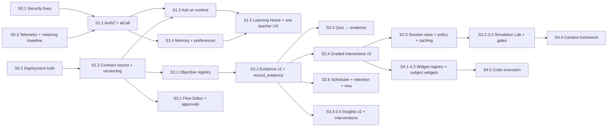

# World-Class AI Teacher — Roadmap, Backlog and Success Metrics

Status: proposal, 2026-11-24. Inputs: [AUDIT](WORLD_CLASS_AI_TEACHER_AUDIT.md),
[VISION](WORLD_CLASS_AI_TEACHER_PRODUCT_VISION.md), [ARCHITECTURE](WORLD_CLASS_AI_TEACHER_ARCHITECTURE.md),
[UX_SPEC](WORLD_CLASS_AI_TEACHER_UX_SPEC.md), [DECISIONS](WORLD_CLASS_AI_TEACHER_DECISIONS.md).

**Planning assumptions.** One founder directing coding agents. A *sprint* = one week, one or two PR-sized backlog
items per agent, at most two agents in parallel on non-overlapping files (the pattern from `NEXT_PHASES_PLAN.md`).
Estimates are in agent-days of focused work plus founder review; treat them as ±50%. Every PR: branch from
`origin/main`, `npm run test:tutor`, `npx tsc --noEmit`, `npx eslint <changed>`, migrations written but **applied by the
owner**, never push to `main` directly.

---

## 1. Roadmap at a glance

| Phase | Theme | Sprints | Outcome in one line |
|---|---|---|---|
| **0** | Audit & consolidation | 3 | Safe to put more institutions on it; we know what's deployed |
| **1** | Unified AI Teacher | 5 | One teacher, one memory, everywhere the learner goes |
| **2** | Adaptive teaching intelligence | 6 | Mastery you can trust; the teacher adapts and schedules revision |
| **3** | Studio & quality assurance | 5 | Educators ship tested, versioned, approved teachers |
| **4** | Advanced interactive learning | 5 | Subject widgets, graded interactions, camera homework (maths) |
| **5** | Platform expansion & scale | ongoing | Low-data/offline revision, local languages (validated), institution intelligence |

**Independent tracks** (can run in parallel once Phase 0 is merged): UX polish (UX-*), Studio editor (S3.1), widgets
(S4.1+) after contract source, telemetry. **Strict sequence:** security → authz/aiCall → (Ask migration, memory);
objective registry → evidence v2 → (quiz evidence, graded interactions, scheduler) → policy → Simulation Lab gate.

---

## 2. Phase 0 — Audit & consolidation (3 sprints)

**Learner/business outcome.** No cross-tenant leaks; costs can't be run up by a single user; the owner knows exactly
which migrations are live; docs stop misleading agents.

**Reuses.** Existing auth helpers, `isSchemaUnavailableError`, `recordUsage`, `session-store` rate limit.
**New.** Fixes, verification SQL, rename of duplicate migration, regenerated types, RLS tests, per-turn limiter,
`after()` metering, kill switch.
**Repo areas.** `src/actions/tutor-authoring.ts`, `src/actions/tutor-learner.ts`, `src/app/api/ai/**`,
`src/app/api/tutor/{try,tts}/**`, `src/lib/tutor/mastery/server.ts`, `src/app/(learner)/dashboard/page.tsx`,
`supabase/migrations/`, `supabase/tests/`, `src/types/database.ts`, `docs/*`.
**DB.** Rename duplicate migration (after checking prod), RLS test additions, `rate_limit_hits` table + function.
**Security.** This *is* the security phase.
**AI cost.** Reduces exposure (unmetered and unlimited paths closed).
**Testing.** Unit tests for every new authz check (deny cases), RLS SQL tests, rate-limit tests.
**Definition of done.** All SEC/PRIV items High+Medium in audit §6 closed or explicitly accepted by the owner; migration
state documented in `docs/DEPLOYMENT.md`; `CLAUDE.md`/`ARCHITECTURE.md`/`TUTOR_API.md` match code.
**Success criteria.** 0 known cross-tenant paths; 100% of AI routes metered or explicitly exempt; prod migration list
verified.

### Sprints
- **S0.1 Security fixes** — P0-01, P0-02, P0-03, P0-04
- **S0.2 Deployment truth** — P0-05, P0-06, P0-07
- **S0.3 Docs, telemetry & cost baseline** — P0-08, P0-09, P0-10

---

## 3. Phase 1 — Unified AI Teacher (5 sprints)

**Outcome.** The learner meets the same teacher (name, voice, memory) in the lesson, in Ask, in practice and on Learning
Home. Conversations persist across devices. The learner can see and correct what the teacher knows.

**Reuses.** `runTutorTurn`, `buildSystemPrompt`, `TutorSession`, `TeachingBoard`, `EventPlayer`, `DailyPlanCard` logic,
`courseTeacher()`, lite mode, persona presets, redesign shells (`docs/redesign/*`).
**New.** `src/lib/authz`, `src/lib/ai/{provider,call}.ts`, contract source + generator, scenario versions, `ask` origin
with streaming, `learner_memories`, `learner_preferences`, "What my teacher knows" page, Up-next card, `TeacherVoice`.
**Repo areas.** `src/lib/ai/**`, `src/lib/tutor/{contract,runtime,learner}/**` (new), `src/lib/tutor/server/**`,
`src/app/api/tutor/**`, `src/app/api/ai/tutor/route.ts` (retire), `src/components/learner/ai-tutor.tsx`,
`src/components/tutor/**`, `src/app/(academy)/academy/[domain]/{classroom,teacher}/**`.
**DB.** `practice_scenario_versions`, `tutor_sessions.{scenario_version,state,contract_version}`, origin enum additions,
`learner_memories`, `learner_preferences`, `learner_habits`, `ai_prompt_caches`.
**Dependencies.** Phase 0. Coordinate with redesign Agent B (student shell) via `docs/redesign/HANDOFF.md`.
**Security.** Ask sessions use the authz layer; no `localStorage` conversation content; memory visibility rules.
**AI cost.** Ask becomes metered (visible cost increase in dashboards, no real increase); cached prefix + window cut
per-turn tokens for long sessions (target −40% tokens per session at turn ≥15).
**Testing.** Contract drift test; Ask streaming parser tests; memory selection tests; version pinning tests; e2e manual
script in Glory Academy.
**Definition of done.** `/api/ai/tutor` serves no traffic (kept 1 release behind a flag, then deleted); dock history
server-side; one voice stack; Up-next card live in classroom home; naming unified.
**Success criteria.** Ask p95 first-`say` latency ≤ current dock first-chunk +300 ms; ≥30% of Ask users return to a
prior conversation on another day (instrumented); memory page visited by ≥10% of active learners in first month.

### Sprints
- **S1.1 Foundations** — P1-01 (authz), P1-02 (aiCall/provider)
- **S1.2 Contract & versions** — P1-03 (contract source), P1-04 (scenario versioning)
- **S1.3 Ask on the runtime** — P1-05 (streaming turn), P1-06 (dock migration)
- **S1.4 Memory** — P1-07 (memories + preferences), P1-08 (What my teacher knows)
- **S1.5 One teacher UX** — P1-09 (Up next card), P1-10 (naming + tenant links + lite everywhere + one voice)

---

## 4. Phase 2 — Adaptive teaching intelligence (6 sprints)

**Outcome.** Mastery reflects demonstrated competence with confidence and decay; the teacher adapts move-by-move;
revision is scheduled for concepts; viva is credible.

**Reuses.** `mastery/evidence.ts` rule (as legacy path), `srs.ts`, `sprint.ts`, `viva.ts`, `objectives.ts` extraction,
quiz actions, report card v2.
**New.** `learning_objectives` registry, evidence v2 + `record_evidence()` SQL function, quiz→evidence, contract v3
graded interactions, `SessionState` reducer, `teachingPolicy`, strategies table, context window + summaries, shared
caches, review scheduler, retention checks, viva review.
**Repo areas.** `src/lib/tutor/learner/**`, `src/lib/tutor/runtime/**`, `src/actions/quizzes.ts`,
`src/components/learner/quiz-player.tsx`, `src/lib/tutor/turn-interaction.ts` (retire regex path),
`src/components/tutor/practice/{Composer,TeachingBoard,ReportCard}.tsx`, `src/lib/tutor/server/report.ts`, migrations.
**DB.** `learning_objectives`, `objective_prerequisites`, `scenario_objectives`, quiz question `objective_id`,
evidence/mastery columns, `record_evidence()`, `tutor_side_effects` outbox.
**Dependencies.** P1-03 (contract source), P1-04 (versions), P1-07 (memory brief).
**Security.** Server-graded answers never sent to client; evidence writes only via SQL function; enrollment asserted.
**AI cost.** Policy adds no model calls; summaries add one cheap call per long session; caching saves more than it costs.
**Testing.** Knowledge rule unit tests + TS/SQL parity test; policy table tests (given state → move); reducer tests;
grader tests per interaction; scheduler tests; migration backfill dry-run on a branch DB.
**Definition of done.** New flows use registered objectives; quiz answers move mastery; ≥50% of evidence in new
sessions is `server_verified`; report reads mastery from DB; revision sessions come from the scheduler; viva has human
review.
**Success criteria.** Learning gain on targeted objectives ≥ +15 pts (pre/post checks); 7-day retention ≥ 65% for
`secure` objectives; misconception repeat rate down 30% vs. baseline cohort.

### Sprints
- **S2.1 Objective registry** — P2-01
- **S2.2 Evidence v2** — P2-02
- **S2.3 Quizzes feed the teacher** — P2-03
- **S2.4 Graded interactions** — P2-04
- **S2.5 Policy & context** — P2-05, P2-06
- **S2.6 Revision & viva** — P2-07, P2-08

---

## 5. Phase 3 — Teacher Studio & quality assurance (5 sprints)

**Outcome.** Educators create, test against simulated learners, version and publish AI teachers in one editor;
institutions see cohort gaps and act on them.

**Reuses.** `LessonAITeacherPanel` (the best existing editor), `FlowStoryboard`, revise/diff, preview client,
templates, Autopilot selection, insights aggregation, review queue.
**New.** Unified Flow Editor, approval workflow, Autopilot-as-drafts, Simulation Lab (simulator, judges, suites,
storage, gate), golden set, insights v2 (cohorts, drill-down, exact aggregates), `tutor_session_reviews`, targeted
interventions.
**Repo areas.** `src/components/tutor/studio/**`, `src/components/creator/**`, `src/lib/tutor/authoring/**`,
`src/lib/tutor/eval/**` (new), `src/app/api/ai/teacher/**`, `src/lib/tutor/insights/**`,
`src/app/(academy)/academy/[domain]/admin/ai-teachers/**`.
**DB.** `ai_eval_suites/runs/results`, `tutor_session_reviews`, insights SQL views/functions, `ai_persona_versions`.
**Dependencies.** P1-04 versions; P2-01 objectives (coverage judge); P2-05 policy (adaptation judge).
**Security.** Eval runs never touch learner tables; judges see no learner PII; staff review respects privacy rules.
**AI cost.** Lab is the largest new cost: ~7 personas × 10 turns × 2 calls + judge ≈ 150 cheap/fast calls per run.
Budget per tenant; cheap model for simulator; run on publish, not on every save.
**Testing.** Deterministic judges unit-tested on fixture transcripts (including known-bad ones); judge calibration
set with human labels (agreement ≥ 0.7); gate logic tests.
**Definition of done.** One editor everywhere; nothing AI-generated reaches a published course without human
publish; Lab gate on by default for new tenants; insights filterable by class group.
**Success criteria.** Lesson → published tested flow median ≤ 10 min; ≥80% of published flows have a passing Lab run;
factual error rate in reviewed samples < 1%.

### Sprints
- **S3.1 One Flow Editor + approvals** — P3-01, P3-02
- **S3.2 Simulation Lab core** — P3-03
- **S3.3 Gates & golden set** — P3-04
- **S3.4 Insights v2** — P3-05
- **S3.5 Review & interventions** — P3-06

---

## 6. Phase 4 — Advanced interactive learning (5 sprints)

**Outcome.** Maths, programming, science, business and health lessons get purpose-built, gradable board widgets;
learners can photograph handwritten maths for feedback.

**Reuses.** `TeachingBoard` renderers (equation, chart, code, table, compare, diagram), formula sandbox, `lowlight`.
**New.** Widget registry (server + client), KaTeX, ~10 widgets, camera homework (maths), code execution via Vercel
Sandbox, Live polish.
**Repo areas.** `src/lib/tutor/contract/widgets/**`, `src/components/tutor/board/**`, `TeachingBoard.tsx`,
`lesson-seek.ts`, `MessageContent.tsx` (retire directives), skill packs.
**Dependencies.** P1-03, P2-04.
**Security.** Image uploads: private bucket, signed URLs, EXIF stripped, retention 30 days, minors policy; code
execution only in Sandbox with no secrets and a timeout.
**AI cost.** Image turns are ~3–5× a text turn; cap per learner per day by plan.
**Testing.** Payload schema tests per widget; grade() tests; visual snapshot of renderers; homework rubric eval set
(50 annotated photos).
**Definition of done.** Registry used by Teaching Room and lesson Ask; old board kinds unchanged; camera homework in beta
for maths flows with teacher override.
**Success criteria.** ≥30% of new non-language flows use a widget with `check`; homework feedback agreement with
teachers ≥ 85% on the eval set.

### Sprints
- **S4.1 Registry** — P4-01
- **S4.2 Maths & code widgets** — P4-02
- **S4.3 Science, business, health widgets** — P4-03
- **S4.4 Camera homework (maths)** — P4-04
- **S4.5 Code execution + Live polish** — P4-05, P4-06

---

## 7. Phase 5 — Platform expansion & scale (ongoing)

| Track | Scope | Gate to start |
|---|---|---|
| **Low-data & offline revision** (P5-01) | PWA install; offline revision decks (concept cards + vocab) with queued results; downloadable lesson text; TTS pre-cache for decks | Phase 2 scheduler live |
| **Local languages, validated** (P5-02) | Validation programme with native-speaker educators per language (explanations, TTS intelligibility, ASR accuracy); publish quality scores; "beta" label until thresholds met; bilingual explanation mode first | Budget for paid reviewers; partner school |
| **Institution intelligence** (P5-03) | Class-level gap heatmaps, at-risk learner signals (no activity, falling mastery), intervention tracking and outcomes, exports for boards/ministries | Phase 3 insights v2 |
| **Adaptive examinations** (P5-04) | Item bank with difficulty from response data (IRT-lite), adaptive practice tests, exam-readiness estimate | ≥ 5k graded responses per course |
| **Budgets & billing UI** (P5-05) | Tenant budget settings, alerts, per-plan learner caps, AI cost per outcome report | P0-10 metering |
| **SLOs & ops** (P5-06) | SLOs (turn p95, Live connect, finalize success), runbooks, on-call alerts, quarterly model review with golden set | P0-09 telemetry |
| **Collaborative learning** | Not planned. Revisit on concrete institutional demand | — |

---

## 8. Implementation backlog

Each item is sized for one agent PR (some split noted). Format: **Objective · User value · Inspect/reuse · Changes ·
Depends on · Acceptance · Tests · Risks.**

### Phase 0

**P0-01 — Close cross-tenant writes in authoring actions** (2d)
- *Objective:* derive tenant from resources in `upsertScenario`, `createTutorAssignment`, `upsertTeacherMoment`,
  `updateCourseVivaConfig`, `createFixItFlowFromMisconception`, autopilot/draft `personaId`, `preview/turn` lesson+persona.
- *User value:* institutions' content cannot be altered or read by other tenants.
- *Inspect:* `src/actions/tutor-authoring.ts:792-871, 1573-1616, 1879-1898, 1065+, 652+`; `src/app/api/ai/teacher/{autopilot,draft,preview/turn}/route.ts`; `src/lib/courses/course-auth*.ts`.
- *Changes:* small local helper `assertRefsInTenant` (becomes P1-01); when `courseId` given, set `companyId = course.company_id` and reject mismatch.
- *Depends:* —
- *Acceptance:* passing another tenant's `companyId`/`scenarioId`/`personaId`/`groupId`/`lessonId` returns 403 and writes nothing.
- *Tests:* unit tests with a fake DB for each deny path.
- *Risks:* legitimate platform (ZEDAI) personas used by tenants — allow-list ZEDAI personas explicitly.

**P0-02 — Lock down learner write actions** (1.5d)
- *Objective:* `recordDockKnowledgeCheck` asserts enrollment (or preview access) and rate-limits; `resolveLearnerCompanyId` validates membership; vocab writes scoped.
- *User value:* mastery and insights can't be polluted; learners can't write into other academies.
- *Inspect:* `src/actions/tutor-learner.ts:24-36, 86, 169, 268-314`.
- *Changes:* enrollment check; membership check; 10/min limiter (in-memory now, DB in P0-09).
- *Acceptance:* non-enrolled course id → `{recorded:false}`; foreign companyId → error.
- *Tests:* unit tests for each guard. *Risks:* guests in free preview lose dock checks (acceptable: don't record evidence for guests).

**P0-03 — Tenant-scope learner reads** (1d)
- *Objective:* daily plan, dock weak-objective notes and insights pass `companyId` and filter scenario `visibility`/enrollment; insights exclude private-session evidence unless shared (PRIV-1).
- *Inspect:* `dashboard/page.tsx:546`, `mastery/server.ts:245-502`, `api/ai/tutor/route.ts:123`, `insights/server.ts:38-41`, `20261123000000_learner_mastery.sql:44-52`.
- *Changes:* required `companyId` param (type-level); join `tutor_sessions` privacy rule for staff evidence reads.
- *Acceptance:* a learner in two academies sees only the current academy's items; staff insights only count lesson/assignment/shared/flagged sessions + quiz evidence.
- *Tests:* unit tests on pure selectors; fixture with two tenants. *Risks:* insights look emptier — explain in UI.

**P0-04 — Close open AI endpoints** (1.5d)
- *Objective:* role checks on stress-test, generate-course-blueprint, edit-block-content, branding-assistant, generate-image; `/try` report goes through the limiter; `/try` requires `public_preview` opt-in on tenant flows; TTS route requires an owned active session and derives company from it.
- *Inspect:* `src/app/api/ai/**`, `src/app/api/tutor/{try,tts}/**`, `public-try.ts:33`.
- *Changes:* guards; migration adding `practice_scenarios.public_preview boolean default false` (platform flows true).
- *Acceptance:* learner calling stress-test → 403; `/try` report beyond limit → 429; TTS without session → 403.
- *Tests:* route-level tests with mocked auth. *Risks:* breaking existing `/try` links for tenant flows — set `public_preview=true` for flows already shared (owner decides via SQL).

**P0-05 — Production migration verification** (0.5d agent + owner)
- *Objective:* produce `docs/ai-teacher/MIGRATION_STATUS.md` with read-only SQL the owner runs (list `supabase_migrations.schema_migrations`, `information_schema.columns` for tutor tables) and a filled-in status table.
- *Changes:* SQL script `scripts/sql/verify-tutor-schema.sql` (SELECT only). *Acceptance:* owner-confirmed list of applied versions; baseline corrected in docs.
- *Risks:* none (read-only). **Agents never connect to production.**

**P0-06 — Fix migration ordering** (0.5d)
- *Objective:* rename the second `20261124000000_*` to `20261124000001_*` (and the `014_*` pair if unapplied) based on P0-05.
- *Acceptance:* `supabase db reset` on a local/branch DB applies all migrations cleanly in order. *Risks:* if prod recorded one under the shared version, renaming must match the recorded one — decide from P0-05.

**P0-07 — Types and RLS tests for tutor tables** (1.5d)
- *Objective:* regenerate `src/types/database.ts`; remove `LooseSupabase` casts where possible; add RLS tests for `learner_mastery`, `learner_evidence`, `teacher_moments`.
- *Inspect:* `supabase/tests/tutor/rls_test.sql`. *Acceptance:* tsc passes without the casts in mastery/insights; RLS tests pass on a local DB.

**P0-08 — Docs reconciliation** (1d)
- *Objective:* update `CLAUDE.md` (Clerk, Gemini, service-role model, proxy.ts), `docs/ARCHITECTURE.md`, `docs/TUTOR_API.md` (v2 events, Live built, routes, limits), `docs/FEATURES.md` AI sections; mark `NEXT_PHASES_PLAN.md` superseded by this set.
- *Acceptance:* every discrepancy in audit §9 resolved. *Risks:* `CLAUDE.md` is owner-curated — PR for review.

**P0-09 — Durable limits, metering and kill switch** (2d)
- *Objective:* Postgres `take_rate_limit()`; per-turn limit; all AI routes meter via `recordUsage` in `after()`; global env kill switch per origin; `maxDuration` on session/complete/authoring routes.
- *Inspect:* `src/lib/tutor/server/usage.ts`, `session-store.ts`, in-memory limiters.
- *Acceptance:* limits hold across instances (test with two processes); usage dashboard includes generation routes.
- *Risks:* DB load from limiter — index + 1h TTL cleanup.

**P0-10 — Turn telemetry baseline** (1d)
- *Objective:* persist `model`, tokens, `fallback`, `dropped_events` on `tutor_turns`; emit custom metrics (turn latency, fallback rate, Live connect failures); stale session sweeper on a schedule.
- *Acceptance:* dashboard query shows p50/p95 latency and fallback rate per day; orphan Live sessions closed within 1h.

### Phase 1

**P1-01 — AuthZ layer** (2d)
- *Objective:* `src/lib/authz/{context,refs,learner}.ts` consolidating `assertTenantStaff`, `canReadCompanyInsights`, `authorizeStaffPreview`, `assertCourseEditor`; P0 helpers move here.
- *Changes:* replace call sites; decide course-owner vs tenant-staff powers (D-13).
- *Acceptance:* the four old helpers deleted; all tutor actions/routes use the layer. *Tests:* table-driven role × action matrix.

**P1-02 — `aiCall` choke point and provider interface** (3d, split: authoring+generation / tutor)
- *Objective:* `src/lib/ai/{provider.ts,gemini/*,call.ts}`; migrate `gemini-calls.ts`, `gemini-models.ts`, `authoring/server.ts` and the regex-JSON generation routes to schema JSON via `aiCall`.
- *Acceptance:* no `@google/genai` import outside `src/lib/ai/gemini/` (except Live client); every call metered. *Tests:* adapter contract tests with a fake provider.
- *Risks:* subtle behaviour changes in generation routes — snapshot test outputs on fixtures.

**P1-03 — Contract single source + versioning** (2d)
- *Objective:* `src/lib/tutor/contract/` generates Zod, Gemini schema, Live tools; drift test; `contract_version` on turns.
- *Inspect:* `events.ts`, `turn-schema.ts` (keep the no-bounds guard), `scripts/gen-tutor-contract.mjs`.
- *Acceptance:* generated artefacts byte-identical in meaning to today's; all 397 tests pass. *Risks:* Gemini schema state limit — keep payloads flat.

**P1-04 — Scenario versioning and pinning** (2.5d)
- *Objective:* `practice_scenario_versions`, `published_version`, session `scenario_version`; runtime loads snapshot; soft delete; restore action.
- *Inspect:* `session-context.ts:190-197`, `tutor-authoring.ts:900` (`deleteScenario`), `zai_tutor.sql:93,107`.
- *Acceptance:* editing a flow mid-session doesn't change that session; deleting archives; restore creates a new version from an old snapshot.
- *Tests:* pinning and restore unit tests. *Risks:* backfill: create v1 for every existing scenario in the migration.

**P1-05 — Streaming turns** (3d)
- *Objective:* `runTutorTurnStream` with an incremental `events` parser; SSE endpoint `POST /api/tutor/sessions/:id/turn?stream=1`.
- *Acceptance:* first `say` delivered before the full JSON completes; non-stream path unchanged. *Tests:* parser on chunked fixtures (split mid-string, escaped quotes, malformed tail → fallback).
- *Risks:* model streaming JSON quirks — fallback to non-stream automatically (D-04).

**P1-06 — Dock migrated to the runtime (`ask` origin)** (3d)
- *Objective:* `ai-tutor.tsx` creates/resumes an `ask` session per learner+lesson; renders events with `TeachingBoard`/`EventPlayer`; quick actions become learner inputs; `:::lesson_ref` → `show_lesson_ref`; dock knowledge checks → `ask_choice` (graded in P2-04; until then teacher_judgement).
- *Inspect:* `src/components/learner/ai-tutor.tsx`, `chat-components/MessageContent.tsx`, `lesson-seek.ts`, `api/ai/tutor/route.ts`.
- *Changes:* behind flag `teacher.ask_runtime`; remove `localStorage` history; keep guest preview path as `demo`-style in-memory session.
- *Acceptance:* parity checklist (starter prompts, lesson seek, board, read-aloud, data saver); conversation visible on another device; metered.
- *Risks:* richer `:::directive:::` widgets (prompt_template, workflow_steps) have no event yet → map to board kinds or keep a temporary `show_board kind=note`; list gaps in PR.

**P1-07 — Learner memories, preferences, habits** (3d)
- *Objective:* tables per Architecture §4.4; `buildLearnerBrief`; post-session summariser in outbox; migrate `learner_language_profiles.memory`; first-meeting question.
- *Acceptance:* brief ≤600 tokens; summariser produces ≤1 episode + ≤3 candidates with source refs; streak no longer split by language.
- *Tests:* brief selection tests; summariser output schema tests. *Risks:* summariser hallucinating facts → only store items with a turn reference; learner can delete.

**P1-08 — "What my teacher knows" page** (2d)
- *Objective:* learner page listing memories, objective states (with evidence trail), preferences; edit/hide/delete/export; staff-visibility indicator.
- *Acceptance:* delete removes from brief immediately; export downloads JSON. *Tests:* action tests incl. ownership.

**P1-09 — Up next with <Teacher> card** (2d)
- *Objective:* replace `DailyPlanCard` + `TutorSpotlightBanner` + academy tiles with one `TeacherUpNextCard` in the redesign classroom home (UX §3).
- *Coordinate:* redesign Agent B owns the shell; this item owns the card.
- *Acceptance:* one primary action + ≤2 secondary; tenant-correct links.

**P1-10 — One teacher, everywhere** (3d, split)
- *Objective:* naming per UX §1.3; academy-scoped lesson/practice links (fix `/courses/...` and `/practice/deck` hard-codes); lite mode honoured by block card, deck, start panel; lazy-load Rive; `TeacherVoice` used by dock, session and deck (no browser `speechSynthesis` for the teacher); persona by key not index; dead `onComplete` and duplicate `BlockRenderer` removed.
- *Acceptance:* audit §8 items closed; Lighthouse mobile on lesson page JS reduced (Rive not in initial bundle).

### Phase 2

**P2-01 — Objective registry** (3d)
- *Objective:* `learning_objectives`, `objective_prerequisites`, `scenario_objectives`; lesson panel and Autopilot persist extracted objectives; Studio "Course objectives" review list; prerequisite suggestions (AI, human-confirmed).
- *Inspect:* `authoring/objectives.ts`, `lesson-ai-teacher-panel.tsx`, `autopilot/route.ts`.
- *Acceptance:* new flows reference objective ids; prefix lists `id: text`; `note_evidence.objective` accepts ids.
- *Risks:* extra creator step — default "accept all", edit inline.

**P2-02 — Evidence v2 and `record_evidence()`** (3d)
- *Objective:* columns per Architecture §4.1; SQL function with transactional update; TS rule `learner/knowledge.ts`; parity test; dual-write legacy `level`; backfill legacy rows (`source='legacy_ai'`); fix stored report levels (read back from DB); unique key includes `company_id`.
- *Acceptance:* concurrent writes don't lose updates (test with parallel calls on local DB); report levels match DB.
- *Risks:* migration on a large evidence table — batch backfill script, not in migration.

**P2-03 — Quizzes feed the knowledge model** (2d)
- *Objective:* optional `objective_id` on quiz questions (AI-suggested in quiz editor, creator confirms); `saveQuizAttempt` records evidence per question; quiz result offers "Go through these with <Teacher>".
- *Inspect:* `src/actions/quizzes.ts:159-244`, `quiz-player.tsx`.
- *Acceptance:* failing a question with an objective lowers that objective; CTA starts a revision session seeded with those ids.
- *Risks:* guest client-side grading (SEC-13) — guests never record evidence.

**P2-04 — Graded interactions (contract v3)** (4d, split server/client)
- *Objective:* `ask_choice.answer`, `ask_order`, `ask_fill`, `ask_numeric`; pending-check in state; `/turn` accepts `{interaction}`; grader; Composer widgets render from events; retire regex inference in `turn-interaction.ts` for new turns (keep for replay).
- *Acceptance:* answer keys never present in client payloads (test asserts stripped); verified evidence recorded; Live path supports interaction answers via `/events`.
- *Risks:* model forgetting the answer field → treat as ungraded (teacher_judgement), track rate in telemetry.

**P2-05 — Session state, teaching policy, strategies** (4d)
- *Objective:* `runtime/state.ts` reducer, `runtime/policy.ts`, `runtime/strategies.ts`; teacher note injection; `policy_move` telemetry; persona philosophy settings.
- *Acceptance:* table tests for every rule in Architecture §3.3; Lab comparison (P3-03) later validates benefit.
- *Risks:* over-constraining the model → directives are advisory, short, and A/B-able per tenant flag.

**P2-06 — Context window, summaries, shared caches** (2.5d)
- *Objective:* prefix/brief/window/note split; `ai_prompt_caches` table; cache creation in `after()`; rolling summary beyond 8 turns.
- *Acceptance:* tokens per turn flat after turn 8 (telemetry); cache hit rate > 60% for flows with ≥5 learners/day.
- *Risks:* summary loses details the learner refers back to → keep evidence and objectives in state, not in summary.

**P2-07 — Review scheduler and retention checks** (3d)
- *Objective:* `next_review_at`/stability; `planReviews()`; revision sessions from scheduler; Learning Home "due reviews"; 7/30-day retention checks; vocab and concepts in one queue.
- *Inspect:* `srs.ts`, `mastery/sprint.ts`.
- *Acceptance:* secure objectives reappear on schedule; retention accuracy measured.

**P2-08 — Viva v2** (2.5d)
- *Objective:* viva reads mastery + session evidence; configurable rubric per course; outcome `pass | needs_review | not_yet`; staff review queue for `needs_review` and learner appeals; no fail-open when schema missing (explicit config state instead).
- *Inspect:* `lib/tutor/viva.ts`, `server/viva.ts`, `actions/certificates.ts:100-105`.
- *Acceptance:* certificate issuance requires pass or staff approval; audit trail stored.

### Phase 3

**P3-01 — One Flow Editor** (5d, split)
- *Objective:* a single editor component (from `LessonAITeacherPanel` + storyboard) used in lesson editor, Studio and course tab: objectives, steps, strategy, persona, preview, Lab, versions, publish. Retire `ScenarioEditorModal` and `generate-tutor-scenario`; teacher moments become the only placement model (convert `tutor_session` blocks to moments, keep renderer for old blocks).
- *Acceptance:* every edit path opens the same editor; old routes redirect.

**P3-02 — Approval workflow & Autopilot as drafts** (2d)
- *Objective:* AI output on published courses = draft versions; batch review screen; "publish batch" requires preview or Lab pass; Fix-It as draft + targeted assignment proposal; "publish all" excludes archived.
- *Inspect:* `autopilot/route.ts:320`, `course-tutor-tab.tsx:63,156-170`, `tutor-authoring.ts:652-706, 1752-1779`.

**P3-03 — Simulation Lab core** (5d)
- *Objective:* `src/lib/tutor/eval/{personas,simulator,judges,runner}.ts`; tables; durable runner (D-09); Studio UI to run and read reports (per-persona transcript with flagged turns).
- *Acceptance:* a run on a known-bad fixture flow (leaks answers, never checks) fails with the right reasons; same seed + temp 0 reproduces deterministic-judge scores.

**P3-04 — Gates & golden set** (2d)
- *Objective:* tenant-configurable publish gate; platform golden set (30 flows × 5 personas); CI/manual "run golden set" for prompt/contract/model PRs; comparison view between versions.

**P3-05 — Insights v2** (3d)
- *Objective:* SQL aggregates (no 400-row sampling) by course, class group, objective; per-learner drill-down (respecting privacy); trends over time; "students who need help" list (falling mastery, inactivity).
- *Inspect:* `insights/server.ts`, `misconceptions.ts`, `TeacherInsightsPanel.tsx`.

**P3-06 — Review table & targeted interventions** (2d)
- *Objective:* `tutor_session_reviews`; review queue with filters/pagination; assign a revision or Fix-It flow to selected learners or a group; track whether the intervention moved mastery.

### Phase 4

**P4-01 — Widget registry** (3d) — server `defineWidget`, client map, `payload` string, lite fallback, dock uses the same registry; migrate existing kinds behind the registry without changing their wire format.
**P4-02 — Maths & code widgets** (4d) — KaTeX (lazy), `graph_plot`, `number_line`, `fraction_bars`, upgraded `code` (language-aware highlighting via `lowlight`), `predict_output`, `fix_the_bug` with `check`.
**P4-03 — Science, business, health widgets** (4d) — `labelled_diagram`, `process_steps`, `editable_table`, `decision_tree`, `case_card`; `health-sim` prompt fragment (currently missing).
**P4-04 — Camera homework (maths)** (5d) — capture/compress client-side, private bucket, multimodal grading against a flow rubric, per-step feedback on the board, teacher override, minors policy, eval set of 50 annotated photos.
**P4-05 — Code execution** (3d) — Vercel Sandbox runner for `predict_output`/`fix_the_bug` checks; timeouts; no network; cost cap.
**P4-06 — Live polish** (2d) — image turns in Live, server-measured time, reconnect/resume UX, barge-in tuning, orphan cleanup verified.

### Cross-cutting UX items (any phase after P1-10)

**UX-01** Teaching Room header: overflow menu, 44px targets (UX §5.3). **UX-02** Composer split into mode-specific
trays. **UX-03** Dock a11y: dialog role, Escape, focus trap, `aria-live`. **UX-04** Three.js FPS guard + `onLowPerformance`
→ lite. **UX-05** Split `TutorSession.tsx` into hooks (`useTeacherAudio`, `useRecorder`, `useLiveSession`,
`useBoardState`) and header/footer components — no behaviour change, snapshot-tested.

---

## 9. Success metrics framework

Principle: **outcome metrics lead; engagement metrics only count when they co-move with outcomes.** Each metric has an
owner surface (where it's visible) and an instrument (where its data comes from).

### 9.1 Learning outcomes

| Metric | Definition | Instrument | Target (12 mo) |
|---|---|---|---|
| Learning gain | Mean score on server-verified checks for an objective in the session's last third minus first probe | `learner_evidence` (verified) | +20 pts |
| Mastery progression | Objectives reaching `secure` per active learner per week | `learner_mastery` | ≥3 |
| Retention | Accuracy on 7-day and 30-day reviews of `secure` objectives | scheduler reviews | ≥70% / ≥60% |
| Misconception resolution | Detected misconceptions not repeated in next 2 checks of the objective | evidence sequence | ≥60% |
| Transfer | Accuracy on `independent_task`/difficulty-3 checks after `secure` | evidence | ≥55% |
| External outcome | Course quiz/exam pass rate for teacher users vs. non-users (matched cohorts) | quiz attempts | +10 pts |

### 9.2 Engagement (in service of learning)

| Metric | Definition | Target |
|---|---|---|
| Weekly active learning | Learners with ≥1 verified check in 3 of 7 days | 35% of enrolled |
| Session completion | Teaching sessions reaching wrap-up (not abandoned) | ≥75% |
| Return to teacher | Learners who resume a teacher interaction within 7 days | ≥50% |
| Revision participation | Due reviews completed within 2 days | ≥40% |
| Path completion | Courses completed by teacher users | +15% vs. baseline |

### 9.3 Teaching quality

| Metric | Definition | Target |
|---|---|---|
| Factual accuracy | Errors per 100 reviewed teacher turns (staff sampling + Lab judge) | <1 |
| Objective coverage | Objectives with ≥1 verified check per completed flow session | ≥90% |
| Diagnosis | Lab: planted misconception detected | ≥85% |
| Adaptive intervention quality | After a policy `worked_example`/`prerequisite` move, next check correct | ≥50% |
| Learner satisfaction | 1-tap "Was this helpful?" at session end + periodic CSAT | ≥4.3/5 |
| Educator trust | % flows published after Lab pass; % sessions flagged by staff | ≥80%; <2% |

### 9.4 Product quality & cost

| Metric | Target |
|---|---|
| Text/voice turn latency p95 (first `say`) | ≤2.5 s text, ≤3.5 s voice |
| Live connect success | ≥95% |
| Session failure rate (502/abandoned by error) | <1% |
| Fallback (unusable model output) rate | <2% |
| Finalize side-effect success (after retries) | 99.9% |
| Mobile: lesson page JS (initial) on 3G Android | ≤250 KB compressed; teacher assets lazy |
| Accessibility | WCAG 2.2 AA on learner surfaces; keyboard-only completion of a session |
| AI cost per learning session | ≤ $0.03 text, ≤ $0.12 Live (tracked by origin) |
| **Cost per meaningful outcome** | AI cost / objectives moved to `secure` — tracked monthly, must trend down |

### 9.5 Anti-metrics (watch for harm)

Time-in-app without verified checks; streak-driven sessions with no evidence; rising `teacher_judgement` share vs.
verified; learner memory deletions spiking (trust problem); staff override rate on viva rising.

### 9.6 Experimentation

Per-tenant feature flags for policy and strategy changes; compare matched cohorts on learning gain and retention, not
on engagement alone. Minimum 2-week windows; pre-register the primary metric in the PR description.
